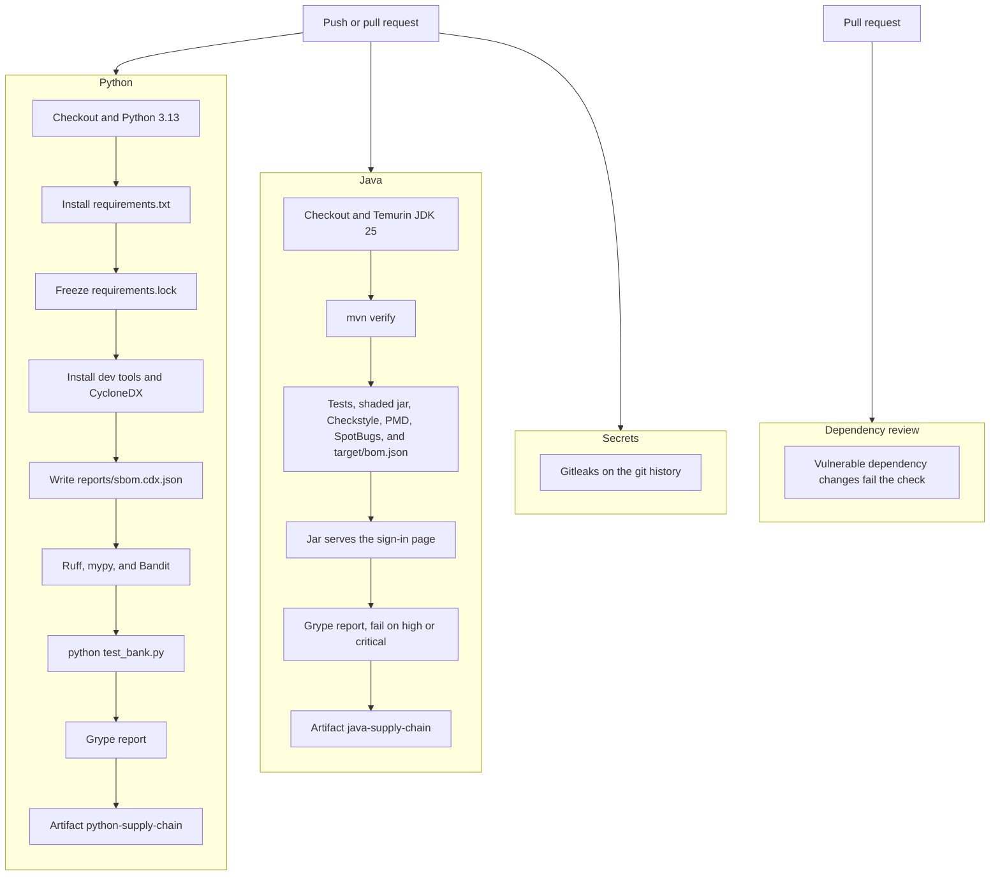
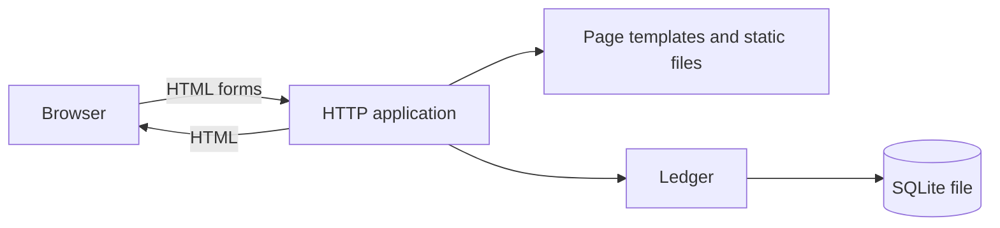

# Northwater architecture

[](https://github.com/claudiol/bank-demo-apps/actions/workflows/ci.yml)
[](https://github.com/claudiol/bank-demo-apps/actions/workflows/ci.yml)

Northwater is a fictional retail bank that runs as one program on your computer. A browser talks to that program. The program keeps customers, accounts, and a ledger in a SQLite file. Nothing is sent to a payment network, another bank, or a remote service.

The same design is implemented twice:

| | Python | Java |
|---|---|---|
| Directory | `northwater/` | `northwater-java/` |
| HTTP | FastAPI and Uvicorn | Javalin and Jetty |
| Pages | Jinja2 | Thymeleaf |
| Default address | http://127.0.0.1:8000 | http://127.0.0.1:8080 |
| Ledger file | `northwater/data/northwater.db` | `northwater-java/data/northwater.db` |

Each implementation has its own database. They do not share sessions or balances.

## Build and run

Both programs listen only on this machine. Sign in as Avery Chen (`avery@northwater.demo`) or Jordan Hale (`jordan@northwater.demo`). The password is `northwater`. `PORT` changes the listen port. `NORTHWATER_DB` changes the ledger file. The first start creates that file and loads the demonstration books.

### Java

Use JDK 25, including `javac`, and Maven 3.9 or newer. Point `JAVA_HOME` at that JDK.

From `northwater-java`:

```bash
mvn -B package
java --enable-native-access=ALL-UNNAMED -jar target/northwater-1.0.0.jar
```

`package` compiles the sources, runs the tests, and builds one shaded jar at `target/northwater-1.0.0.jar`. The jar’s main class is `com.northwater.Northwater`. Open http://127.0.0.1:8080.

`--enable-native-access=ALL-UNNAMED` lets the SQLite driver load its native library on JDK 25. The same flag is set for the tests.

`mvn -B verify` runs the package build and then Checkstyle, PMD, and SpotBugs. That is what the Java CI job runs. `package` also writes a CycloneDX SBOM to `target/bom.json`.

The CI job starts that jar and requests the sign-in page. It then scans the SBOM with Grype 0.121.0 and uploads `target/bom.json` and `target/grype.json`. A high or critical finding fails the Java job. To scan locally after the package build:

```bash
grype sbom:target/bom.json -o table
grype sbom:target/bom.json -o json --file target/grype.json
```

### Python

Use Python 3.13 or newer. From `northwater`:

```bash
python -m venv .venv
.venv/bin/pip install -r requirements.txt
.venv/bin/python app.py
```

Open http://127.0.0.1:8000. Lint and tests use the extra tools in `requirements-dev.txt`:

```bash
.venv/bin/pip install -r requirements-dev.txt
.venv/bin/ruff check .
.venv/bin/ruff format --check .
.venv/bin/mypy
.venv/bin/bandit -c pyproject.toml -r app.py test_bank.py
.venv/bin/python test_bank.py
```

The CI job writes a CycloneDX SBOM of the installed runtime requirements to `reports/sbom.cdx.json`, scans it with Grype, and uploads that SBOM with `reports/grype.json`. To do the same locally, after installing `requirements.txt`:

```bash
mkdir -p reports
.venv/bin/pip freeze > reports/requirements.lock
.venv/bin/pip install "cyclonedx-bom==7.5.0"
.venv/bin/cyclonedx-py requirements reports/requirements.lock --output-file reports/sbom.cdx.json --output-reproducible
grype sbom:reports/sbom.cdx.json -o table
grype sbom:reports/sbom.cdx.json -o json --file reports/grype.json
```

## Continuous integration

A push or a pull request starts the Python, Java, and secret-scanning jobs together. A newer push to the same branch cancels the run already in progress. Pull requests also get a dependency review. The Python Grype scan uploads its report and does not fail the job. The Java scan fails the job when it finds a high or critical issue.

Renovate runs every Monday and opens one pull request for the Java dependency updates. Run it sooner from the Actions tab with **Renovate**. Pull requests opened by that workflow use the repository token, so the CI workflow does not start on them by itself. The Renovate GitHub App avoids that limit.



## Demo: the Java Grype report blocks the merge

This is the walkthrough for a red Java job.

`main` requires the `java` status check. That job writes `northwater-java/target/bom.json` and scans it with Grype 0.121.0. The failing command is:

```bash
grype sbom:target/bom.json --fail-on high -o json --file target/grype.json
```

A high or critical finding makes Grype exit 2. The Java job fails, and the branch ruleset keeps the pull request unmerged. Grype still writes the JSON before it exits, and the job uploads it as the `java-supply-chain` artifact at `northwater-java/target/grype.json`. The same file is the place to look when the log table has scrolled away. The Python scan uploads its report and leaves the Python job green.

The pull request that added this gate failed it on the first run: [Actions run 40764518160](https://github.com/claudiol/bank-demo-apps/actions/runs/40764518160). Open the **Grype report** step on the Java job. The table listed these high and critical issues:

| Severity | Component | Version | Brought in by | Advisory | Fixed in |
| --- | --- | --- | --- | --- | --- |
| Critical | thymeleaf | 3.1.3.RELEASE | direct dependency | [GHSA-xjw8-8c5c-9r79](https://github.com/advisories/GHSA-xjw8-8c5c-9r79) | 3.1.4.RELEASE |
| Critical | thymeleaf | 3.1.3.RELEASE | direct dependency | [GHSA-r4v4-5mwr-2fwr](https://github.com/advisories/GHSA-r4v4-5mwr-2fwr) | 3.1.4.RELEASE |
| Critical | thymeleaf | 3.1.3.RELEASE | direct dependency | [GHSA-c9ph-gxww-7744](https://github.com/advisories/GHSA-c9ph-gxww-7744) | 3.1.5.RELEASE |
| High | jetty-http | 11.0.25 | Javalin 6.7.0 | [GHSA-355h-qmc2-wpwf](https://github.com/advisories/GHSA-355h-qmc2-wpwf) | 11.0.29 |
| High | jetty-security | 11.0.25 | Javalin 6.7.0 | [GHSA-2fvj-hgj9-j2gr](https://github.com/advisories/GHSA-2fvj-hgj9-j2gr) | 11.0.31 |

Jetty is not a direct dependency. Javalin 6.7.0 brings Jetty 11.0.25. The 11.0.29 and 11.0.31 releases named in those advisories are not on Maven Central. The newest Jetty 11 artifacts published there are 11.0.26, and Grype still reports that line as affected. A Jetty 11 pin in the POM leaves the high findings in place.

The fix is the version change in `northwater-java/pom.xml`:

- Thymeleaf moves from `3.1.3.RELEASE` to `3.1.5.RELEASE`. That clears the three critical findings on the direct dependency.
- Javalin moves from `6.7.0` to `7.2.4`. Javalin 7 depends on Jetty 12.1.14, which replaces the Jetty 11.0.25 artifacts.

Javalin 7 registers routes on `config.routes`, reads the banner flag from `config.startup.showJavalinBanner`, and uses `org.eclipse.jetty.ee10.servlet.SessionHandler`. `BankApp` follows that API. The session cookie stays `northwater`, HttpOnly, and SameSite Lax.

After `mvn -B package`, run the same Grype command locally. It exits 0. One medium finding can remain: OGNL 3.3.4 ([GHSA-crwc-vw2r-qr6m](https://github.com/advisories/GHSA-crwc-vw2r-qr6m), fixed in 3.4.13), which Thymeleaf 3.1.5 still brings in. The Java gate fails on high and critical, so that medium finding leaves the job green. With `java` and `python` both green, the ruleset allows the merge.

### Make the Java job fail again

Do this on a branch. `main` rejects a direct push. One version in `northwater-java/pom.xml` is enough to fail the Grype step. Leave Javalin at `7.2.4` so the sources still compile, the jar still serves the sign-in page, and the job reaches Grype.

In the Thymeleaf dependency, replace `3.1.5.RELEASE`:

```xml
    <dependency>
      <groupId>org.thymeleaf</groupId>
      <artifactId>thymeleaf</artifactId>
      <version>3.1.5.RELEASE</version>
    </dependency>
```

with `3.1.3.RELEASE`:

```xml
    <dependency>
      <groupId>org.thymeleaf</groupId>
      <artifactId>thymeleaf</artifactId>
      <version>3.1.3.RELEASE</version>
    </dependency>
```

Commit that file and push the branch. Open a pull request, or push to the branch that already has one. The Java job runs `mvn -B verify`, serves the sign-in page, then the Grype step exits 2 on the three critical Thymeleaf advisories in the table above. The `java-supply-chain` artifact still uploads. The `java` check stays red, so the ruleset keeps the pull request unmerged.

To bring the Jetty high findings back as well, change the Javalin dependency in the same file from `7.2.4`:

```xml
    <dependency>
      <groupId>io.javalin</groupId>
      <artifactId>javalin</artifactId>
      <version>7.2.4</version>
    </dependency>
```

to `6.7.0`:

```xml
    <dependency>
      <groupId>io.javalin</groupId>
      <artifactId>javalin</artifactId>
      <version>6.7.0</version>
    </dependency>
```

Javalin `6.7.0` pulls Jetty 11.0.25, which is the pair of high findings in the table. `BankApp` is written for Javalin 7, so this second edit also needs the Javalin 6 route registration or `mvn verify` fails at compile time and Grype does not run. The original red run, [Actions run 40764518160](https://github.com/claudiol/bank-demo-apps/actions/runs/40764518160), had both versions at once: Thymeleaf `3.1.3.RELEASE` and Javalin `6.7.0`.

Put the two versions back to `3.1.5.RELEASE` and `7.2.4` to make the Grype step pass again.

## Components



**Browser.** The customer uses ordinary pages: sign in, overview, account statement, move money, pay a bill, review, and receipt. A small script disables a submit button after it is pressed, and shows the account-number field only when the destination is another Northwater customer. Fonts, CSS, and that script are served by the application.

**HTTP application.** This is the front door. It checks the session, checks the form token, validates input, and chooses the next page. Signed-in pages redirect to sign-in when there is no session. Unknown pages and accounts that belong to someone else return a not-found page. Responses send a content-security policy that allows only this application’s own files.

**Page templates.** The application fills HTML templates with the signed-in customer, balances, and the statement. Customer-supplied text is inserted as text, so a memo cannot become markup. A one-time notice, such as “Signed out.”, is stored in the session and removed when the next page is rendered.

**Ledger.** This is the only place that reads and writes money. Amounts are integer cents. An account balance is stored on the account and must match the running total of that account’s transactions. On startup the ledger opens the SQLite file, turns on foreign keys and write-ahead logging, and loads the demonstration books if the file is new or from an older seed.

**SQLite file.** One local file holds the whole bank. The path can be changed with `NORTHWATER_DB`. The port can be changed with `PORT`.

## What the ledger stores

- **Customers.** Two demonstration customers, Avery Chen and Jordan Hale. Passwords are stored as PBKDF2-HMAC-SHA256 hashes. Both use the demonstration password `northwater`.
- **Accounts.** Each customer has a checking account and a savings account. Account numbers and the routing number are labels in this demo. They are not wired to a real network.
- **Transactions.** Every posted amount, with the description, category, memo, and the balance after that line. The statement is this list. Searching it treats `%` and `_` as ordinary characters.
- **Transfers.** The record of a completed move or bill payment: confirmation number, a one-time nonce, the accounts involved, and the amount. Replaying the same nonce returns the original confirmation and does not move the money again.
- **Seed marker.** A version key. When it does not match the current seed, the file is rebuilt from the demonstration history.

The seed is a few months of payroll, rent, groceries, and transfers, plus monthly savings interest at 3.80% APY. Moves between a customer’s own accounts cancel out. The October transfer between Avery and Jordan cancels out across the two customers.

## How a request moves

Reading is direct. The overview and the statement ask the ledger for accounts, recent lines, and this month’s totals. Transfers between a customer’s own accounts are left out of the overview month totals and included on the account statement.

Moving money takes three steps, and the money does not move until the last one:

1. **Prepare.** The customer submits the form. The application checks the account, the destination, and the amount, then stores a pending transfer in the session. The review page describes it. Opening the form again clears that pending transfer.
2. **Confirm.** The customer posts the review form. The application checks the form token and that the nonce still matches the pending transfer.
3. **Post.** Inside one database transaction, the ledger debits the source, credits the destination when there is one, writes the statement lines, and stores the transfer. Then it commits. If the nonce was already used, it rolls back and returns the original confirmation.

A bill payment debits the customer and records the payee’s name. It does not credit another customer. A move between the customer’s own accounts is labeled an internal transfer. A move to the other customer is labeled a transfer and appears on both statements.

The pending transfer lives only in the session. The ledger is unchanged until confirm succeeds.

## Boundaries

The process binds to this machine. There is no separate API service, message queue, identity provider, or payment gateway. Sign-in is a cookie session that lasts up to eight hours. Each form carries a token that must match the session.

The two demonstration customers can see their own accounts and a receipt for a transfer they sent or received. They cannot open each other’s statements.
